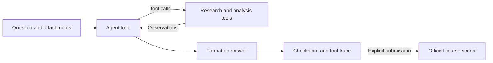

# GAIA Research Agent

[](#quick-start)
[](validation/official-score.json)
[](VALIDATION.md)
[](LICENSE)

A Python agent for the [Hugging Face Agents Course final assignment](https://huggingface.co/learn/agents-course/unit4/hands-on). It uses OpenAI models and tools to research questions, inspect files, perform calculations, and produce answers for the course's GAIA evaluation.

**Verified result: 45% (9/20 correct), above the course's 30% target.** The official scoring API confirmed the result and updated the leaderboard on October 26, 2026.

[Public Hugging Face source](https://huggingface.co/spaces/adamitistime/gaia-research-agent) · [Official scoring response](validation/official-score.json) · [Validation record](VALIDATION.md)

## Contents

- [Evaluation result](#evaluation-result)
- [Quick start](#quick-start)
- [Usage](#usage)
- [How it works](#how-it-works)
- [Configuration](#configuration)
- [Hugging Face deployment](#hugging-face-deployment)
- [Project structure](#project-structure)
- [Development and validation](#development-and-validation)
- [Limitations](#limitations)
- [License](#license)

## Evaluation result

| Metric | Recorded result |
| --- | --- |
| Official score | **45.0%** |
| Correct answers | **9 of 20** |
| Answers submitted | 13 |
| Questions unresolved | 7: five unavailable attachments and two unanswered research questions |
| Course target | 30% |
| Leaderboard account | `adamitistime` |
| Evaluation date | October 26, 2026 |

The score uses all 20 questions as its denominator, including unresolved questions. The scorer reports the total correct count without identifying individual correct or incorrect answers.

The agent generated the submitted answers from questions and tool observations. No benchmark answer key or hardcoded task-answer lookup is included. This is one recorded run; changes to models, sources, or question availability can affect future results.

Evidence: [scoring response](validation/official-score.json), [run summary](validation/evaluation-summary.json), and [validation details](VALIDATION.md). Full question-level logs stay in the local `runs/` directory and are excluded from Git.

## Quick start

### Prerequisites

- Python **3.12** and Git.
- An OpenAI API key with available API credits.
- Optional: a Hugging Face token with access to the gated GAIA dataset for attachment questions.
- Optional: [Stockfish](https://stockfishchess.org/download/) for chess analysis.

### 1. Clone and install

The commands below use Windows PowerShell and invoke the virtual environment directly, so activation is unnecessary.

```powershell
git clone https://github.com/adembilge/gaia-research-agent.git
cd gaia-research-agent
py -3.12 -m venv .venv
.\.venv\Scripts\python.exe -m pip install -r requirements.txt
Copy-Item .env.example .env
```

Dependencies are pinned in [requirements.lock.txt](requirements.lock.txt). Their original version ranges are in [requirements.in](requirements.in).

### 2. Configure the API key

Open `.env`, set `OPENAI_API_KEY`, and keep `INFERENCE_PROVIDER=openai`. The example already selects the default text, vision, and speech models.

OpenAI handles inference and billing. Hugging Face credentials are used separately for gated dataset access and deployment. Store keys in `.env` locally or in Space secrets when hosting the Python app; `.env` is excluded from Git.

### 3. Launch the app

```powershell
.\.venv\Scripts\python.exe app.py
```

Open **[http://127.0.0.1:7860](http://127.0.0.1:7860)**. The local server binds to `127.0.0.1`. Restart it after changing `.env`.

After configuring `.env`, you can also run `powershell -ExecutionPolicy Bypass -File .\start.ps1` to create the environment if needed, install dependencies, and launch the app.

## Usage

### Gradio interface

| Tab | Workflow |
| --- | --- |
| Course evaluation | Generate answers, inspect results, resume interrupted runs, and submit to the official scorer. |
| Try a question | Solve a custom question and inspect tool observations and usage. |

To evaluate the course questions:

1. Select **Generate / resume answers**.
2. Review the answer table and download `results.json` for source URLs, tool calls, observations, attachment hashes, timing, and usage.
3. Run the same action again to retry failures. Successful unchanged questions are reused.
4. Select **Submit answers to leaderboard** when ready. Enable **Allow partial submission** to submit despite unresolved questions; missing answers still count against the full 20-question score.

Generating answers does not submit them. A successful submission response is saved, and submitting the same payload again returns the saved response. Timed-out submission requests are not automatically retried because the server may already have processed them.

For local UI submission, set `AGENT_SPACE_ID=YOUR_USERNAME/gaia-research-agent` in `.env` and enter your Hugging Face username in the app. A hosted Gradio Space obtains the code URL from `SPACE_ID` and the username through OAuth.

### Command line

Check configuration and the live course API without using inference credits:

```powershell
.\.venv\Scripts\python.exe -m gaia_agent doctor
```

Test a custom question:

```powershell
.\.venv\Scripts\python.exe -m gaia_agent solve "What is 6 multiplied by 7? Give only the number."
```

Evaluate one course question, then resume the same directory for the remaining questions:

```powershell
.\.venv\Scripts\python.exe -m gaia_agent evaluate --limit 1 --run-dir runs/my-run
.\.venv\Scripts\python.exe -m gaia_agent evaluate --run-dir runs/my-run
```

Submit a completed run after publishing the source in a public Space:

```powershell
.\.venv\Scripts\python.exe -m gaia_agent submit --run-dir runs/my-run --username YOUR_USERNAME --space-id YOUR_USERNAME/gaia-research-agent
```

Explicitly allow a partial submission when some questions remain unresolved:

```powershell
.\.venv\Scripts\python.exe -m gaia_agent submit --run-dir runs/my-run --username YOUR_USERNAME --space-id YOUR_USERNAME/gaia-research-agent --allow-partial
```

### Checkpoints and run history

Results are saved after each question. Resume reuses successful answers when the question and run configuration still match. Changed questions are recomputed; changes to the implementation or model configuration require a new run directory.

Each Gradio browser session has its own run directory. Browser state is not a persistent account history, and Space storage can disappear on restart. Download logs you need to retain. CLI runs can be resumed with the same `--run-dir`.

## How it works

The agent uses native tool calls through the OpenAI chat API. It receives a question and registered attachment names, requests tools when needed, examines their observations, and returns a short answer in the requested format.



The loop has bounded steps and output size. Authentication, permission, billing, and quota failures stop evaluation and preserve a checkpoint. Final-answer cleanup removes wrapping code fences or a `FINAL ANSWER:` prefix while preserving names, numbers, and punctuation.

| Tool | Purpose |
| --- | --- |
| `web_search`, `read_web` | Search the web, extract HTML/PDF text, follow source links, and read long documents in sections. |
| `read_file` | Read PDF, XLSX, DOCX, PPTX, text, CSV, and Python source attachments. |
| `spreadsheet_sum` | Sum selected numeric cells with decimal arithmetic and report every included value. |
| `calculator`, `text_operation` | Perform bounded arithmetic, reverse text, and sort comma-separated lists. |
| `inspect_image` | Inspect an image attachment or public image URL with the vision model. |
| `transcribe_audio` | Transcribe an audio attachment with the configured speech model. |
| `youtube_transcript` | Retrieve timestamped video captions. |
| `inspect_video` | Transcribe a short video's audio or inspect frames at selected timestamps. |
| `analyze_chess` | Analyze a verified FEN with Stockfish and return SAN, evaluation, and principal variation. |

The agent has access to registered attachments rather than unrestricted local files. Python attachments are read as source and reasoned through; no shell or arbitrary code-execution tool is exposed. Public-URL downloads block local and private network addresses and validate redirects. Inference endpoints are checked before credentials are sent.

## Configuration

Copy [.env.example](.env.example) to `.env` and adjust the values you need.

| Variable | Default | Purpose |
| --- | --- | --- |
| `OPENAI_API_KEY` | Required for OpenAI inference | API credential. |
| `INFERENCE_PROVIDER` | `openai` | Select `openai` or `huggingface`. |
| `MODEL_ID` | `gpt-4.1` | Main model for answers and tool calls. |
| `VISION_MODEL_ID` | `gpt-4.1` | Model for images and video frames. |
| `ASR_MODEL_ID` | `gpt-transcribe` | Speech recognition model. |
| `MODEL_BASE_URL` | `https://api.openai.com/v1` | Endpoint for the selected inference provider. |
| `MAX_STEPS` | `18` | Tool-loop iterations before a final-answer request. |
| `MAX_TOKENS` | `4096` | Maximum completion tokens per model request. |
| `REQUEST_TIMEOUT` | `90` | Model request timeout, in seconds. |

The default models passed live text/tool-call, image, and audio checks on October 26, 2026. API references: [GPT-4.1](https://developers.openai.com/api/docs/models/gpt-4.1) and [file transcription](https://developers.openai.com/api/docs/guides/speech-to-text).

### Optional credentials and integrations

| Variable | Purpose |
| --- | --- |
| `HF_DATASET_TOKEN` | Read token with access to `gaia-benchmark/GAIA` for attachment fallback. |
| `HF_TOKEN` | Fallback credential for dataset reads and deployment; also used in Hugging Face inference mode. |
| `HF_DEPLOY_TOKEN` | Write-capable token for the uploader; falls back to `HF_TOKEN`. |
| `AGENT_SPACE_ID` | Public source Space, in `username/space-name` format, for local UI submission. |
| `STOCKFISH_PATH` | Local Stockfish executable for chess analysis. |
| `ALLOWED_HF_USERS` | Comma-separated trusted users allowed to invoke inference in a hosted Gradio Space, in addition to its owner. |

<details>
<summary>Use Hugging Face inference instead of OpenAI</summary>

Set `INFERENCE_PROVIDER=huggingface` and use these values together:

| Variable | Value |
| --- | --- |
| `MODEL_BASE_URL` | `https://router.huggingface.co/v1` |
| `MODEL_ID` | `openai/gpt-oss-120b` |
| `VISION_MODEL_ID` | `Qwen/Qwen2.5-VL-72B-Instruct` |
| `ASR_MODEL_ID` | `openai/whisper-large-v3` |
| `HF_ASR_PROVIDER` | `hf-inference` |

Provide an `HF_TOKEN` with Inference Providers permission and available credits. The provider and endpoint must match.

</details>

### GAIA attachment access

During validation on October 26, 2026, all five course `/files/{task_id}` requests returned HTTP 404. The client first tries that endpoint, then falls back on HTTP 403/404 to the exact attachment at `gaia-benchmark/GAIA/2023/validation/<task_id>.<extension>`.

To enable the fallback, accept the conditions on the [official GAIA dataset page](https://huggingface.co/datasets/gaia-benchmark/GAIA) and give `HF_DATASET_TOKEN` read access to that dataset. If unset, the client uses `HF_TOKEN`. Only the requested attachment is downloaded; answer metadata and annotations are not retrieved.

## Hugging Face deployment

The published [adamitistime/gaia-research-agent Space](https://huggingface.co/spaces/adamitistime/gaia-research-agent) is a **static source mirror**. The evaluated Python agent ran locally, and the submission links to this public source. The static page does not execute Python or store API keys.

The account's Gradio hosting request returned HTTP 402 during validation because PRO was required for that hosting. Choose the mode your account supports.

### Static source mirror

Set a write-capable `HF_DEPLOY_TOKEN` locally, then publish the source and a static overview page:

```powershell
.\.venv\Scripts\python.exe deploy.py YOUR_USERNAME/gaia-research-agent --sdk static
```

Run the Python agent locally to generate answers.

### Running Gradio app

For an account with eligible Gradio hosting:

```powershell
.\.venv\Scripts\python.exe deploy.py YOUR_USERNAME/gaia-research-agent
```

In the Space's **Settings → Variables and secrets**, add `OPENAI_API_KEY` as a secret and `HF_DATASET_TOKEN` if gated attachments are needed. Model IDs can be configured as variables. Organization-owned Spaces should put the operator's personal username in `ALLOWED_HF_USERS`.

The Gradio configuration enables Hugging Face OAuth. Only the owner and explicitly allowed users can invoke inference. Hosting this backend requires `app.py`, `gaia_agent/`, requirements files, `packages.txt`, and the README configuration; `packages.txt` installs Stockfish.

The uploader scans files against configured secret values and excludes `.env`, local runs, and the virtual environment. It refuses to update an existing Space unless `--update` is supplied. Local secrets are never transferred; a static mirror needs none.

## Project structure

```text
gaia-research-agent/
├── app.py                       # Gradio interface
├── gaia_agent/
│   ├── agent.py                 # Tool-calling loop and answer handling
│   ├── config.py                # Provider settings and safe error reporting
│   ├── course.py                # Course API and attachment fallback
│   ├── evaluation.py            # Checkpoints, resume, and submission
│   ├── model.py                 # Chat, vision, and speech clients
│   ├── net.py                   # Bounded public-URL downloads
│   ├── tools.py                 # Research and analysis tools
│   └── __main__.py              # CLI commands
├── tests/                       # Unit tests and integration fixtures
├── scripts/smoke_live.py         # Read-only live checks
├── validation/                  # Checks and official score evidence
├── deploy.py                    # Static or Gradio Space uploader
├── start.ps1                    # Windows setup and launch helper
├── .env.example                 # Configuration template without credentials
├── requirements.lock.txt        # Pinned runtime dependencies
├── packages.txt                 # Stockfish dependency for hosted execution
└── VALIDATION.md                # Verification scope and limitations
```

## Development and validation

```powershell
.\.venv\Scripts\python.exe -m pip install -r requirements-dev.txt
.\.venv\Scripts\python.exe -m pytest -q
.\.venv\Scripts\python.exe -m ruff check .
.\.venv\Scripts\python.exe scripts/smoke_live.py
```

**48 automated tests passed** in the recorded validation. They cover tool-call handling, bounded calculations, spreadsheet aggregation, attachment access, credential separation, checkpoint reuse, submission behavior, quota failures, and authorization. Model and scorer tests use synthetic fixtures and mocks; their pass count is separate from GAIA accuracy.

The smoke script checks live questions, attachment retrieval, search, webpage/PDF extraction, and provider mappings in Hugging Face mode. It saves results under `runs/live-smoke/` without invoking inference or submitting answers. Recorded OpenAI checks and scoring evidence are in [validation/](validation/).

## Limitations

| Area | Current behavior |
| --- | --- |
| Evaluation coverage | Five attachment questions and two research questions remained unresolved in the passing run. |
| Scanned PDFs | Text extraction is supported; OCR is not implemented. |
| Spreadsheets | Reads are capped at 2,000 rows and 80 columns. Formulas use stored Excel values without recalculation; source formulas can be inspected. |
| Long documents | Extracted webpage/PDF text is capped at 600,000 characters. |
| Video analysis | Videos are limited to ten minutes and 75 MiB, with up to 12 sampled frames per call. Sparse sampling cannot establish an exact visual maximum. |
| YouTube access | Captions and downloads can be blocked by YouTube or the runtime IP. |
| Python attachments | Source is reasoned through without arbitrary code execution. Complex programs may exceed this approach. |
| Chess | Stockfish depends on a correctly transcribed board and an available executable. |
| Hosted authentication | Authorization logic is tested locally; OAuth in a running hosted Gradio Space has not been verified. |

## License

Released under the [MIT License](LICENSE).
